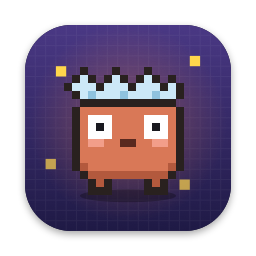
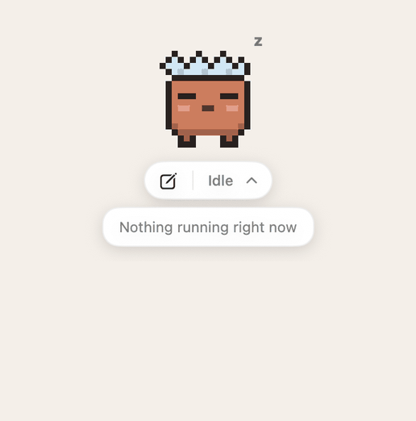
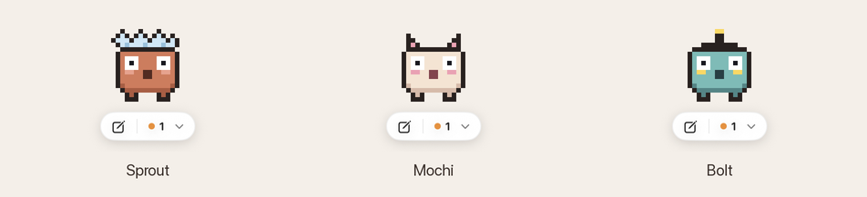

<p align="center"></p>

<h1 align="center">Claude Pet</h1>

<p align="center">
  <b>A tiny pixel pet that floats on your Mac and tells you which Claude Code chats are working, need you, or just finished.</b><br>
  So you can work in other apps without checking back every two minutes.
</p>

<p align="center">
  <a href="../../releases/latest"></a>
  
  <a href="../../actions/workflows/build.yml"></a>
  <a href="LICENSE"></a>
</p>

<p align="center"></p>

## Why

Claude Code is great at long tasks, which means a lot of waiting and a lot of checking: is it done? Is it stuck on a permission prompt? Which of my five chats finished?

Claude Pet sits on top of whatever you're doing and answers that at a glance:

- 🟠 **Needs you**: a chat is waiting on a permission prompt or a question
- 🔵 **Working**: Claude is busy
- 🟢 **Done**: a chat finished and you haven't read it yet (it matches the blue dots in Claude's sidebar)

Click a card to jump straight into that chat. The pet reacts too: it naps when nothing is running, puts on goggles while Claude works, and jumps when something finishes.

## Install

With [Homebrew](https://brew.sh):

```bash
brew install --cask pielord757/tap/claude-pet
```

Or download **[ClaudePet.zip](../../releases/latest)**, unzip it, and move `ClaudePet.app` to Applications.

It isn't notarized yet, so the first time, right-click the app → **Open** → **Open** (or run `xattr -dr com.apple.quarantine /Applications/ClaudePet.app`). It works with the Claude desktop app's Code tab and with `claude` in a terminal. Apple Silicon, macOS 14 or newer.

Update with `brew upgrade --cask claude-pet`.

<details>
<summary><b>Build from source</b> (one command, no Xcode project, no dependencies)</summary>

You need Xcode or just the Command Line Tools (`xcode-select --install`).

```bash
git clone https://github.com/PieLord757/claude-pet.git
cd claude-pet
./build.sh
open ClaudePet.app
```

`build.sh` compiles `Sources/main.swift`, runs the self-tests, draws the app icon, and wraps everything in an app bundle. If your default SDK is newer than your compiler (common after a Command Line Tools update), it falls back to an older installed SDK that works. This also gives you an Intel build.
</details>

## Pets

<p align="center"></p>

Right-click the pet → **Pet** to switch between Sprout, Mochi and Bolt, or **Import Pet…** to bring your own. Claude Pet reads the same sprite format as Codex pets, and any pets you already have in `~/.codex/pets` show up automatically.

**Made a pet?** See [docs/PETS.md](docs/PETS.md) for the format, then [share it](../../issues/new?template=new-pet.yml) so it can join the gallery.

## Using it

| Do this | To |
| --- | --- |
| Click the pet, or the `⌄` in the pill | Show or hide the session cards |
| Drag the pet | Move it (the position is remembered) |
| ✎ in the pill | Start a new Claude Code session |
| Click a card | Open that chat in Claude (a terminal session brings its terminal forward) |
| Right-click the pet | Pets, size, idle sessions, clear finished, reset position, **Close Pet** |

- **Open it:** `⌘ Space` → **ClaudePet**. **Start at login:** System Settings → General → Login Items → **+**.
- **`/pet` in Claude Code (optional):** `mkdir -p ~/.claude/commands && cp extras/pet.md ~/.claude/commands/pet.md`, then `/pet` opens it and `/pet close` closes it.

## Privacy

Everything stays on your Mac. The pet makes **no network requests**. It only reads Claude Code's local session status files and the desktop app's local chat list, and it writes only its own preferences and the pets you import. Details in [docs/HOW-IT-WORKS.md](docs/HOW-IT-WORKS.md).

## FAQ

**Does it work without the desktop app?** Yes. Terminal `claude` sessions show up too; their Done cards clear after 30 minutes or with right-click → Clear Finished.

**Will a Claude update break it?** Possibly. It reads internal files that aren't a documented API. The parsing is small and covered by tests, so it's quick to fix. [Open an issue](../../issues/new?template=bug.yml) if it stops matching your sidebar.

**Does it steal focus?** No. The pet never takes keyboard focus, so you can keep typing in whatever app you're in.

## Contributing

Bug reports, pets, and pull requests are all welcome. [CONTRIBUTING.md](CONTRIBUTING.md) explains the one-file layout and the tests, and [good first issues](../../issues?q=is%3Aissue+is%3Aopen+label%3A%22good+first+issue%22) are a nice place to start.

If Claude Pet saves you a few tab switches, a ⭐ helps other people find it.

---

<sub>Unofficial fan project. Not affiliated with or endorsed by Anthropic. "Claude" is a trademark of Anthropic.</sub>
