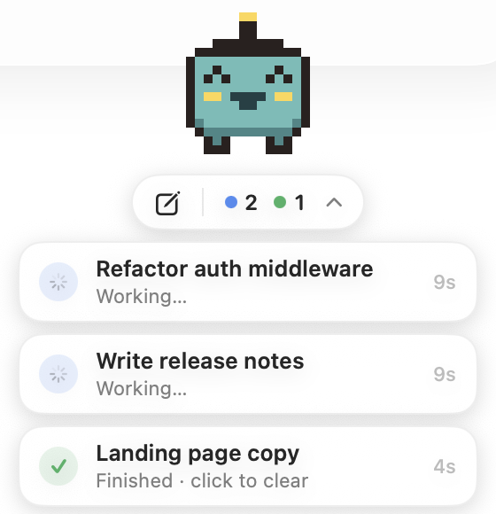

<p align="center"></p>

# Claude Pet

A small floating pet for macOS that keeps an eye on your [Claude Code](https://claude.com/claude-code) sessions, so you can work in other apps and still see at a glance what's happening.

<p align="center"></p>

It floats above every app and desktop and shows:

- 🟠 **Needs you**: a session is blocked on a permission prompt or a question
- 🔵 **Working**: Claude is busy in that session
- 🟢 **Done**: a session just finished (the pet cheers; the card clears when you read that chat in Claude, or when you click it)

The pet reacts too: it sleeps when nothing is running, gets busy while Claude works, and jumps when something finishes.

It works with sessions in the Claude desktop app's Code tab and with `claude` in a terminal.

> Unofficial fan project. Not affiliated with or endorsed by Anthropic.

## Install

### Option 1: download the release

1. Download `ClaudePet.zip` from the [latest release](../../releases/latest) and unzip it.
2. Move `ClaudePet.app` to `/Applications`.
3. The app is not notarized, so macOS blocks the first launch. Right-click the app → **Open** → **Open**, or run:

   ```bash
   xattr -dr com.apple.quarantine /Applications/ClaudePet.app
   ```

The release build is for Apple Silicon Macs. On Intel, build it yourself (below).

### Option 2: build it yourself

Requirements: macOS 14 (Sonoma) or newer, and Xcode **or** just the Command Line Tools (`xcode-select --install`).

```bash
git clone https://github.com/PieLord757/claude-pet.git
cd claude-pet
./build.sh
open ClaudePet.app
```

`build.sh` compiles the single Swift file `Sources/main.swift` with `swiftc`, draws the app icon, and wraps everything in an app bundle. There's no Xcode project and there are no dependencies. If your default SDK is newer than your compiler (common after a Command Line Tools update), the script falls back to an older installed SDK that works.

## Using it

| Do this | To |
| --- | --- |
| Click the pet, or the `⌄` in the pill | Show or hide the session cards |
| Drag the pet | Move it (the position is remembered) |
| ✎ in the pill | Start a new Claude Code session |
| Click a **Needs you** card | Open Claude's "Sessions Waiting for You" view |
| Click a **Working** card | Bring Claude to the front |
| Click a **Done** card | Clear it and bring Claude to the front |
| Right-click the pet | Choose a pet, import a pet, change size, show idle sessions, reset position, **Close Pet** |

Clicking a card can't jump straight to that exact chat, because the Claude desktop app doesn't expose a link for it. PRs welcome if you find one.

### Opening and closing

- **Open:** press `⌘ Space` and type **ClaudePet**, or open it from Applications.
- **Close:** right-click the pet → **Close Pet**.
- **Start at login:** System Settings → General → Login Items → **+** → `ClaudePet.app`.

### `/pet` inside Claude Code (optional)

A slash command that opens or closes the pet from any Claude Code chat:

```bash
mkdir -p ~/.claude/commands && cp extras/pet.md ~/.claude/commands/pet.md
```

Then `/pet` opens it and `/pet close` closes it. The Claude desktop app's own menus can't be extended by other apps, so this is the closest thing to a built-in button.

## Pets

Right-click the pet → **Pet** to switch. You get:

- **Built in:** Sprout (the default), Mochi, and Bolt. These are drawn in code.
- **Your Codex pets:** any pet in `~/.codex/pets/` (or `$CODEX_HOME/pets/`) shows up automatically with "(Codex)" after its name. Claude Pet uses the same format as Codex pets.
- **Imported pets:** right-click → **Import Pet…** and choose either a Codex pet folder (`pet.json` + sprite sheet) or a bare sprite sheet image. Imports are copied to `~/Library/Application Support/ClaudePet/pets/`. **Open Pets Folder** takes you there.

### Sprite sheet format (Codex-compatible)

- A PNG or WebP atlas, **8 columns × 9 rows** of **192×208** cells (1536×1872 total), transparent background.
- Each row is one animation. Empty cells at the end of a row are skipped:

| Row | Animation | Claude Pet plays it when |
| --- | --- | --- |
| 0 | idle | nothing needs attention (slowed down when everything is quiet) |
| 1 | running right | you drag the pet to the right |
| 2 | running left | you drag the pet to the left |
| 3 | waving | (not used yet) |
| 4 | jumping | a session just finished |
| 5 | failed | (not used yet) |
| 6 | waiting | a session needs you |
| 7 | running | Claude is working |
| 8 | review | (not used yet) |

Any row that's empty falls back to idle, so a sheet with just an idle row still works.

A pet folder looks like this:

```text
my-pet/
├── pet.json
└── spritesheet.webp
```

```json
{
  "id": "my-pet",
  "displayName": "My Pet",
  "description": "One short sentence.",
  "spritesheetPath": "spritesheet.webp"
}
```

## How it works

Every running Claude Code session writes a small status file to `~/.claude/sessions/<pid>.json` with its name and a `status` of `busy`, `waiting` or `idle` (plus a `waitingFor` reason when blocked). Claude Pet polls that folder once a second:

- Only `*.json` files are read there. Nothing else in `~/.claude` is touched.
- A session counts only while its process is alive (`kill(pid, 0)`).
- A busy → idle change shows as **Done** after a 3 second debounce, and expires after 30 minutes.
- For chats in the Claude desktop app, a **Done** card clears by itself once you've seen the chat: when you open it after it finished, or when it's the chat on screen as it finishes. The pet reads only the `lastFocusedAt` time from the app's per-chat file in `~/Library/Application Support/Claude/claude-code-sessions/`. Terminal sessions have no such file, so clear those by clicking the card.
- The app makes no network requests. It writes only its own preferences (`defaults read local.claudepet`) and the pets you import.

⚠️ That status file is an internal Claude Code detail, not a documented API. A future Claude Code update could change it and break the pet. If that happens, the parsing lives in `SessionStore.poll()`.

## Hacking on it

Everything is in [`Sources/main.swift`](Sources/main.swift):

- **`SessionStore`** reads the session files and tracks waiting/working/done.
- **`BuiltinPet` / `PixelPet` / `PetCanvas`** are the built-in pixel pets. Each row is a 16-character string and each character is a palette color (`K` outline, `O` body, `W` hair, `.` transparent). Add a `BuiltinPet` with its own top rows and colors, then list it in `BuiltinPet.all`.
- **`SpriteSheet` / `PetLibrary` / `PetFigure`** load, import and animate Codex-format pets.
- **`PetView` / `ControlPill` / `SessionStack` / `SessionToast`** are the SwiftUI interface.
- **`AppDelegate`** creates the always-on-top, all-desktops panel and sizes it to its content.
- **`IconRenderer`** draws the app icon from the Sprout sprite (`ClaudePet --render-icon <dir>`).

### Testing without real sessions

Point the pet at a fake folder with `CLAUDE_PET_SESSIONS_DIR`. The `pid` must be a live process, so a `sleep` works:

```bash
mkdir -p /tmp/fake-sessions
sleep 600 &
echo "{\"pid\":$!,\"sessionId\":\"demo\",\"name\":\"Demo session\",\"status\":\"busy\"}" > /tmp/fake-sessions/$!.json
open --env CLAUDE_PET_SESSIONS_DIR=/tmp/fake-sessions ClaudePet.app
```

Change `"busy"` to `"waiting"` (add `"waitingFor":"approve Bash"`) or to `"idle"` to see the other states. Only one Claude Pet runs at a time, so close the real one first.

## Ideas for forks

- Use the waving, failed and review rows (for example, failed when a session errors)
- A sound or a macOS notification when something needs you
- Per-session deep links, once the desktop app supports them
- A menu bar mode

## License

[MIT](LICENSE)
